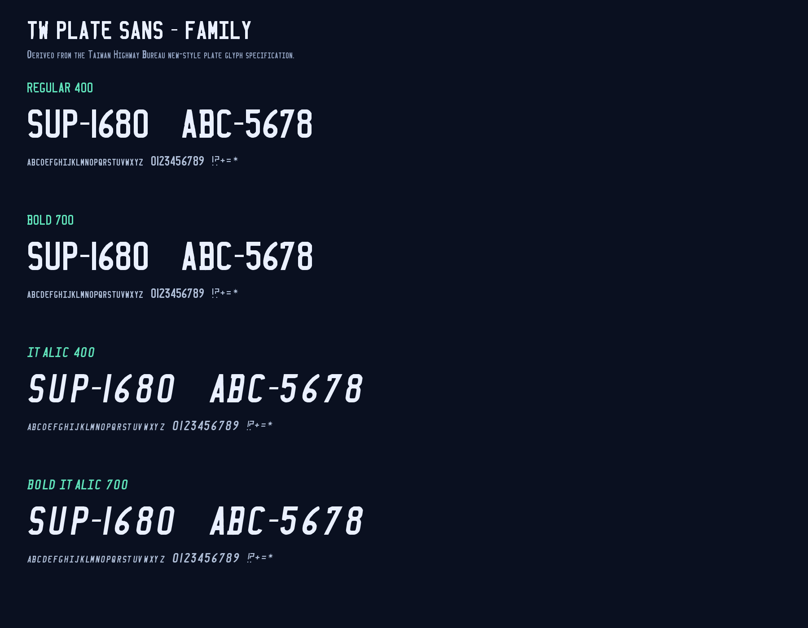

# ALPR-123

<p align="center"></p>

A small, self-hosted license plate recognition service for a fixed camera. It is designed for Home Assistant automations such as opening a garage door when a known vehicle arrives.

**Installation:** [English](docs/INSTALL.md) | [繁體中文](docs/INSTALL.zh-TW.md)

## Why this exists

Running a full ALPR model against every frame of a 15 fps camera is wasteful on a small host. ALPR-123 uses a vehicle-first pipeline at 2 fps, a motion gate, optional per-camera ROI, multi-frame plate voting, and a tracked gate line. It then sends one small JSON event to Home Assistant over a webhook.

The project does not require MQTT, an HA add-on, or a cloud service.

## Features

- Vehicle detection followed by plate detection and OCR (`fast-alpr`).
- Motion gate so models are skipped when nothing changes.
- Optional normalized ROI per camera; motion and detection ignore everything outside the ROI, and the area is outlined on the live view.
- Runtime camera switching from the web UI, persisted across restarts.
- Multi-frame plate voting and a tracked gate line for `enter` / `exit` events; cars that pass by or stop short of the line are recorded as `pass` / `stop`.
- SQLite event history and JPEG snapshots with a retention period you can change in the web UI (1–365 days, default 7).
- Each saved snapshot draws a small reference plate using the bundled TW Plate Sans font, so the OCR result can be compared with the official plate lettering.
- Built-in web UI: live camera, last event, searchable history, image modal, and ROI editor.
- Home Assistant webhook integration with a sample automation, helpers, and webpage panel.
- Native Home Assistant custom integration with config flow, sensors, health entities, and an `alpr_gate_event` bus event.
- launchd template for macOS and systemd template for Linux.

## Typography

The repository bundles the **TW Plate Sans** family: Regular, Bold, Italic, and Bold Italic. It covers A–Z, small-caps a–z, 0–9, the plate hyphen, and basic punctuation. See [`assets/fonts/README.md`](assets/fonts/README.md) for installation and source notes.



The bundled UI labels are in Traditional Chinese. They are plain HTML strings and can be localized by editing `dashboard.html`.

## Pipeline

```text
RTSP 2 fps -> optional ROI -> motion gate -> vehicle detector
           -> vehicle crop -> fast-alpr -> multi-frame vote
           -> tracked gate line -> enter/exit event
           -> SQLite + JPEG snapshot -> HA webhook
```

Vehicle detection is the first model because full-frame plate detection misses small plates. The plate detector runs only on vehicle crops.

## Requirements

- Python 3.10–3.13 and `ffmpeg`.
- macOS on Apple Silicon (tested) or Linux with a CPU/GPU supported by ONNX Runtime.
- An RTSP source. A `go2rtc` instance is recommended because it can expose a low-rate ALPR stream and a smooth live stream.
- Home Assistant if you want webhook automations.

The default models are downloaded on first run and cached under `~/.cache/open-image-models` and `~/.cache/fast-plate-ocr`.

## Quick start

```sh
git clone https://github.com/kingwap99/ALPR-123.git
cd ALPR-123

/opt/homebrew/bin/python3.11 -m venv venv
venv/bin/pip install -U pip
venv/bin/pip install -r requirements.txt

cp config.example.yaml config.yaml
chmod 600 config.yaml
# Edit config.yaml: RTSP URLs, camera labels, live URLs, webhook URL.

venv/bin/python alpr_gate.py --config config.yaml --dry-run
```

Open `http://ALPR_HOST:8099/`. Select a camera, draw its ROI with **Detection area**, and confirm that the live view and event history work before enabling automations.

The first RTSP frame can take 10–30 seconds while ffmpeg waits for a keyframe. Health checks return 503 until the first frame is available.

## Camera model

Each camera has its own RTSP source, resolution, line, direction, live URL, and optional ROI. Camera IDs are arbitrary; they must match the go2rtc stream names in your configuration.

The UI selector switches immediately. Programmatic selector updates during page load are guarded, so reloading the page does not send an accidental switch request. The service stops the current capture, starts the selected one, resets the tracker, and persists the choice in `active_camera.json`. The models stay loaded.

Recommended setup:

- `garage` / test camera: 960×960, 2 fps ALPR stream, car parked in a known place.
- `driveway` / production camera: 1920×1080, 2 fps ALPR stream, `enter_direction: down` (adjust after a real pass).
- A separate 15 fps live stream for the web UI. It is only consumed while the UI is open.

## ROI

ROI is a normalized rectangle `{x, y, width, height}` in `0..1` coordinates. It is applied before the motion gate and vehicle detector. This reduces the number of model runs caused by unrelated motion. It does not reduce H.264 decoding cost; if CPU remains high, lower the ALPR stream resolution or crop in ffmpeg before the raw output.

The gate line is specified in full-frame coordinates and automatically adjusted to the ROI crop. Keep the line inside the ROI.

## Configuration highlights

- `cameras`: per-camera source, line, direction, live URL, optional ROI.
- `active_camera`: initial camera on first start; the UI persists the latest selection in `active_camera.json`.
- `plates.allow`: optional strict allowlist. An empty list means observe all plates; Home Assistant can still filter.
- `ha.webhook_url`: Home Assistant webhook URL. Leave empty for dry-run mode.
- `storage.data_dir`: SQLite database and snapshots. The default is `~/Library/Application Support/alpr-gate` on macOS.

See `config.example.yaml` for all fields.

## Home Assistant

### Native integration (recommended)

Copy `custom_components/alpr_gate` into the Home Assistant configuration directory, restart HA, then open **Settings → Devices & Services → Add Integration → ALPR-123** and enter the ALPR host and port (default `8099`).

The integration creates last-plate, last-event, last-seen, events-today, camera, confidence, camera-online, and service-online entities. It fires `alpr_gate_event` with `direction`, `plate`, `plate_normalized`, `confidence`, `camera`, `snapshot`, and `seen_at`. When Home Assistant has an internal URL, the integration also registers its webhook with the ALPR service automatically; otherwise it polls status/history every five seconds.

Use `examples/home_assistant/integration_automation.yaml` for an event-triggered automation.

### Webhook automation (optional)

The older webhook trigger plus helpers remains supported:

1. Create a long random webhook ID in Home Assistant.
2. Add the automation in `examples/home_assistant/automation.yaml`.
3. Add the helpers in `examples/home_assistant/helpers.yaml`.
4. Set `ha.webhook_url` to `http://HOME_ASSISTANT_HOST:8123/api/webhook/<id>`.
5. Use `local_only: true` on the webhook trigger and keep the service on a trusted LAN.

The sample automation updates helpers, creates a persistent notification, and optionally pulses a garage-door relay only when the event came from the production camera and the door contact says closed.

To put the web UI in the HA sidebar, create a **Webpage panel** dashboard pointing to `http://ALPR_HOST:8099/` (Settings → Dashboards → Add dashboard → Webpage panel). The panel is LAN HTTP; a remote HTTPS HA session may block the embedded HTTP iframe.

An optional `panel_iframe` snippet is included in `examples/home_assistant/panel_iframe.yaml`.

## API

| Method | Path | Purpose |
|---|---|---|
| GET | `/health` | 200 when the worker has a fresh frame, otherwise 503 |
| GET | `/status` | Camera, frame age, last event, motion value |
| GET | `/api/events` | History with `limit`, `offset`, `plate`, `direction`, `date` |
| GET | `/api/cameras` | Camera list and active camera |
| POST | `/api/cameras/{id}` | Switch active camera |
| POST | `/api/cameras/{id}/roi` | Set or clear a normalized ROI |
| POST | `/api/integration/webhook` | Register the HA integration webhook |
| DELETE | `/api/integration/webhook` | Clear the HA integration webhook |
| GET | `/snapshots/{name}` | Event JPEG |
| GET | `/last.jpg` | Last saved event JPEG |

The webhook payload is:

```json
{
  "event": "enter",
  "plate": "AB1234",
  "confidence": 0.998,
  "camera": "driveway",
  "snapshot": "http://ALPR_HOST:8099/snapshots/20261022-120000-1-AB1234-enter.jpg",
  "seen_at": "2026-10-22T12:00:00+08:00",
  "track_id": 1
}
```

## Security

The API and snapshots have no built-in authentication. Bind the service to a trusted LAN, do not port-forward it, and keep `config.yaml` at mode `600` because it contains RTSP credentials and the webhook secret. License plate recognition can be spoofed with a photo; do not make a garage door depend on OCR alone. Use a door contact, a manual enable switch, time windows, and a physical safety device.

## Repository layout

```text
alpr_gate.py                 service and web API
dashboard.html               web UI
config.example.yaml          annotated example configuration
requirements.txt             Python dependencies
deploy/                      launchd, systemd, and installer templates
scripts/                     macOS installer
assets/                     icon, icon SVG, and the TW Plate Sans family
examples/go2rtc.yaml         go2rtc stream examples
examples/home_assistant/     webhook automation, helpers, panel notes
custom_components/alpr_gate/ native Home Assistant integration
docs/                        installation, architecture, API
```

## License

MIT. `fast-alpr`, `open-image-models`, and their model licenses are separate; review their upstream terms before redistribution.
